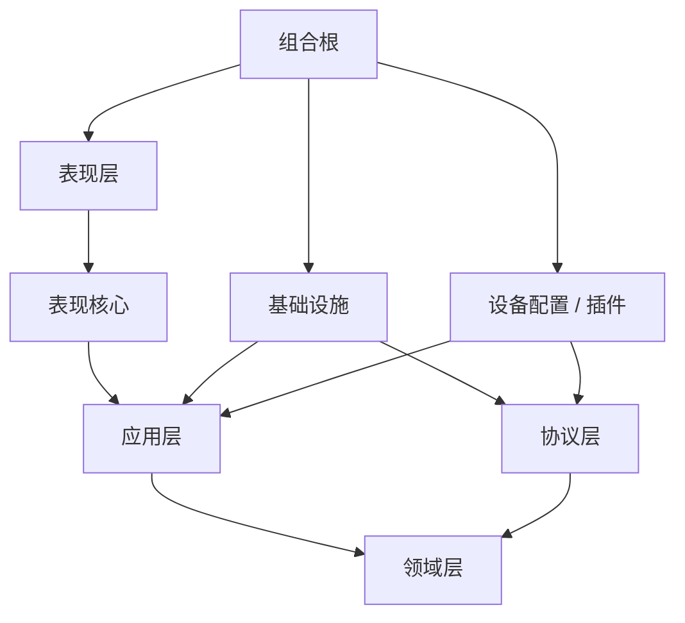

# 上位机架构设计

> 本模板描述当前契约，不记录日期、轮次、“本轮完成”或变更流水。过程证据交给 Git、构建日志和测试报告。

## 1. 范围

| 项目 | 内容 |
|---|---|
| 产品 / 工具 | `<名称>` |
| 目标用户 | `<用户与使用场景>` |
| 运行平台 | `<Windows / Linux / 其他>` |
| UI 技术 | `<Avalonia / WinUI / WPF / Qt / 命令行>` |
| 设备连接 | `<串口 / TCP / USB / 模拟器>` |
| 不在范围 | `<明确排除项>` |

## 2. 变化轴与质量属性

| 变化轴 | 必须隔离在 | 不允许扩散到 |
|---|---|---|
| 设备协议 | Protocol / Profile | ViewModel、Domain |
| 设备型号与能力 | Profile | Infrastructure、UI |
| UI 布局与视觉 | Presentation | Application、Domain |
| 连接方式（串口/TCP/仿真） | Infrastructure | Application 用例 |
| 文件格式与导出 | Infrastructure | Domain、ViewModel |

必须明确的质量属性：

- 可测试性：核心用例是否可在无窗口、无真实硬件环境下运行；
- 可恢复性：断线、超时、取消、重连是否有确定结果；
- 可定位性：能否用 `correlation_id` 串起命令、tx/rx、解码、响应、状态迁移、read model 和 UI，并录制最小故障包；
- 可观测性：错误、命令结果、队列丢弃、stale 和命令门 owner 是否能按时间线追踪；
- 可移植性：协议和业务逻辑是否与 UI/OS 解耦；
- 资源边界：线程、队列、文件句柄和连接是否有 owner。

## 3. 业务能力切片

| 能力 | 主要用例 | 状态所有者 | 对外端口 |
|---|---|---|---|
| 连接管理 | `<连接、断开、重连>` | `<DeviceSession>` | `<IDeviceTransport>` |
| 命令控制 | `<发送、ACK、超时>` | `<CommandService>` | `<ICommandTransport>` |
| 遥测 | `<采集、合并、stale>` | `<TelemetryStore>` | `<ITelemetrySink>` |
| 导出 | `<选择路径、写文件>` | `<ExportService>` | `<IExportService>` |
| 升级 | `<校验、安装、回滚>` | `<UpgradeService>` | `<IUpgradeInstaller>` |

## 4. 依赖图



规则：

- 依赖只能指向内层或稳定契约；
- 模块不必零依赖或独立部署，但必须有职责、测试和替换边界；
- 同一业务切片可以组合多个 Application/Domain 类型；共享契约优于复制实现；
- Domain 不依赖 UI、文件、网络、串口、JSON 或日志框架；
- Application 不创建具体 adapter；
- Infrastructure 不引用具体 Profile 或 Presentation；
- Presentation 不直接依赖 Infrastructure；
- App 是唯一组合根。

## 5. 模块职责

| 模块 | 唯一主要变化原因 | 输入 | 输出 | 禁止内容 |
|---|---|---|---|---|
| `<Domain 模块>` | `<业务规则变化>` | `<值对象>` | `<判定/结果>` | `<I/O、UI、日志框架>` |
| `<Application 模块>` | `<用例流程变化>` | `<命令/查询>` | `<结果/read model>` | `<具体连接、窗口>` |
| `<Protocol 模块>` | `<协议字段变化>` | `<字节>` | `<消息/快照>` | `<UI、文件、业务策略>` |
| `<Infrastructure 模块>` | `<外部技术变化>` | `<端口请求>` | `<适配结果>` | `<业务规则、设备变体分支>` |
| `<Presentation.Core 模块>` | `<展示状态变化>` | `<用例结果>` | `<read model>` | `<具体控件、文件 I/O>` |
| `<Presentation 模块>` | `<界面变化>` | `<绑定/用户输入>` | `<命令调用>` | `<协议解析、串口操作>` |

## 6. 端口与适配器

| 端口 | 定义位置 | 真实适配器 | Fake/Simulator | 契约测试 |
|---|---|---|---|---|
| `<IDeviceTransport>` | `<Application>` | `<Serial/Tcp>` | `<FakeTransport>` | `<open/send/read/close>` |
| `<IProtocolCodec>` | `<Application>` | `<Protocol>` | `<FakeCodec>` | `<半帧/粘包/CRC>` |
| `<IExportService>` | `<Application>` | `<FileExport>` | `<FakeExport>` | `<成功/取消/失败>` |
| `TimeProvider` | `<Application/BCL>` | `<System>` | `<FakeTimeProvider>` | `<推进/超时>` |

端口按用例设计，不按厂商库 API 形状设计。

## 7. 数据传递契约

| 消息类型 | 关联键 | 顺序要求 | 满队列策略 | 关闭语义 |
|---|---|---|---|---|
| CommandResult | `correlation_id` | 与命令一一对应 | 不静默丢弃 | 未完成命令以取消/超时结束 |
| TelemetrySnapshot | `device_id + sequence` | 新 sequence 不被旧值覆盖 | 合并/丢旧值 | 停止生产并标 stale |
| Event/Log | `sequence` | 保留发生顺序 | 有界，记录 dropped_count | 排空或带证据丢弃 |

统一信封字段：

```text
message_id
correlation_id
device_id
profile_id
schema_version
sequence
captured_at
kind
payload
error
```

所有权规则：

- C# 使用不可变 record/readonly struct、`ReadOnlyMemory<byte>` 和有界 `Channel<T>`；
- C++ 使用值语义、`unique_ptr`、`std::span` 和明确的有界队列；
- 队列中不保存调用期借用的引用、`span`、裸 `this` 或 UI 控件；
- 大 payload 使用快照、移动语义或 `shared_ptr<const T>`，并写明共享原因。

## 8. 线程与生命周期

| 执行体 | 谁创建 | 谁停止 | 更新 UI 的方式 | 资源释放 |
|---|---|---|---|---|
| UI 线程 | `<框架>` | `<应用关闭>` | `<直接更新>` | `<窗口销毁>` |
| Transport 读循环 | `<DeviceSession>` | `<CancellationToken/stop_token>` | `<dispatcher>` | `<await/join>` |
| Reconnect 循环 | `<DeviceSession>` | `<CancellationToken>` | `<dispatcher>` | `<await/join>` |
| Log writer | `<App>` | `<shutdown>` | `<不可直接更新>` | `<flush + dispose>` |

必须写清：

- 停止生产 -> 取消等待 -> 停止消费 -> 等待任务 -> 释放资源；
- UI 线程不 `.Result` / `.Wait()`；
- 后台线程不直接修改 UI 控件或集合；
- 异步回调有 owner、取消信号和结束等待点。

## 9. 错误与恢复

| 错误类别 | 触发条件 | 可重试 | UI 展示 | 证据 |
|---|---|---|---|---|
| Transport | `<断线/写失败>` | `<按命令风险>` | `<连接状态 + 错误>` | `<原始错误/设备>` |
| Timeout | `<ACK 超时>` | `<只读命令可一次>` | `<命令失败>` | `<命令/耗时/attempt>` |
| Protocol | `<CRC/长度/版本>` | `<否>` | `<协议错误>` | `<原始响应>` |
| Cancelled | `<用户取消>` | `<否>` | `<已取消>` | `<命令/阶段>` |
| VersionMismatch | `<固件/Profile 不匹配>` | `<否>` | `<不可继续>` | `<双方版本>` |

### 9.1 可定位性契约

| 项目 | 当前契约 |
|---|---|
| 关联 ID | `<session_id / correlation_id / user_action_id>` |
| 原始字节 | `<tx/rx 录制位置、时间戳、容量和脱敏>` |
| 解码证据 | `<帧摘要、CRC、长度、命令 ID、错误码>` |
| 状态迁移 | `<Disconnected/Connecting/Ready/stale/faulted 记录点>` |
| 命令门 | `<owner、等待时长、超时/取消/释放原因>` |
| 队列与丢弃 | `<容量、积压、dropped_count、丢弃类别>` |
| 回放能力 | `<transport replay / fake clock / golden frames>` |
| 故障包 | `<版本、配置、步骤、时间线、日志、快照、修复前后对比>` |
| 敏感信息 | `<脱敏、容量上限、保留周期、导出权限>` |

## 10. 组合根

```text
读取配置
  -> 创建 TimeProvider / logger / file services
  -> 创建 transport factory
  -> 创建 protocol/profile registry
  -> 创建 DeviceSession / Application services
  -> 创建 Presentation.Core read models
  -> 创建窗口和 UI 服务
  -> 启动接收循环与 UI 主循环
  -> 注册有序关闭
```

组合根不解析协议、不计算业务指标、不决定 UI 文案。

## 11. 测试矩阵

| 层 | 必须覆盖 | 不启动 |
|---|---|---|
| Domain | 边界、单位、回绕、不变量 | 窗口、硬件、文件 |
| Application | 成功、超时、取消、断线、重连、命令门 | 真实串口 |
| Protocol | 黄金帧、半帧、粘包、CRC、版本 | UI |
| Presentation.Core | 状态、命令可用性、stale、错误文案 | 真实窗口 |
| Infrastructure | 适配器契约、资源释放、异常转换 | 业务规则 |
| UI E2E | 少量绑定和线程切换 | 大量业务分支 |

## 12. 架构适应度函数

- [ ] `.NET` 项目引用图无环且方向正确；
- [ ] `CMake` target 依赖图无环且方向正确；
- [ ] Domain 不引用 I/O、JSON、UI、串口或日志框架；
- [ ] Application 不创建具体 adapter；
- [ ] Infrastructure 不引用具体 Profile 或 Presentation；
- [ ] Presentation 不直接引用 Infrastructure；
- [ ] ViewModel 不直接读写文件、串口、网络；
- [ ] 端口有 fake 和真实 adapter 的共用契约测试；
- [ ] 命令门、ACK、超时、取消有唯一负责人；
- [ ] telemetry 有 `sequence`、`stale` 和有界队列策略；
- [ ] 命令、响应、状态迁移和 read model 有 correlation id 可串联；
- [ ] 原始 tx/rx 或等价录制可用于回放定位；
- [ ] 故障修复有第一处偏差、修复前后同输入对比和回归测试；
- [ ] 关闭顺序有测试或可复现推演。

自动检查：

```powershell
powershell -NoProfile -ExecutionPolicy Bypass -File scripts\check_dotnet_architecture.ps1 -Root <software-root>
powershell -NoProfile -ExecutionPolicy Bypass -File scripts\check_cmake_architecture.ps1 -Root <cpp-root>
```

## 13. 风险与未决项

| 风险 / 未决项 | 当前处理 | 需要谁决定 | 验证方式 |
|---|---|---|---|
| `<旧固件兼容>` | `<降级策略>` | `<负责人>` | `<兼容测试>` |
| `<Profile 发现方式>` | `<静态注册/配置>` | `<负责人>` | `<启动测试>` |
| `<高吞吐队列>` | `<容量/丢弃策略>` | `<负责人>` | `<压力测试>` |
